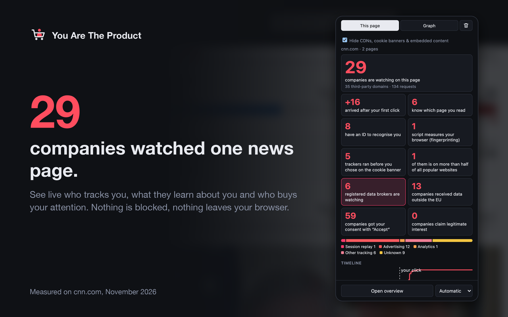
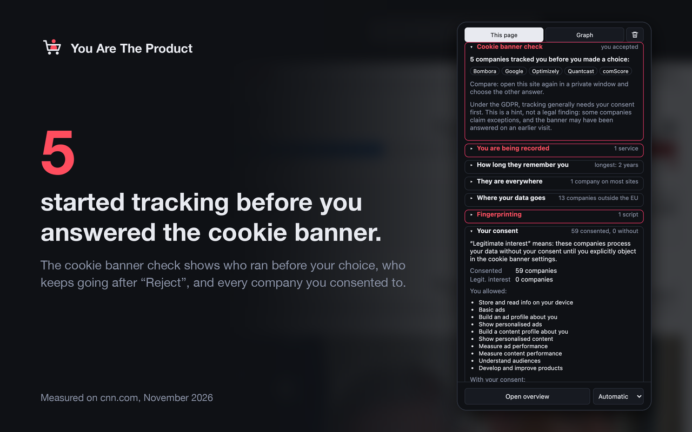
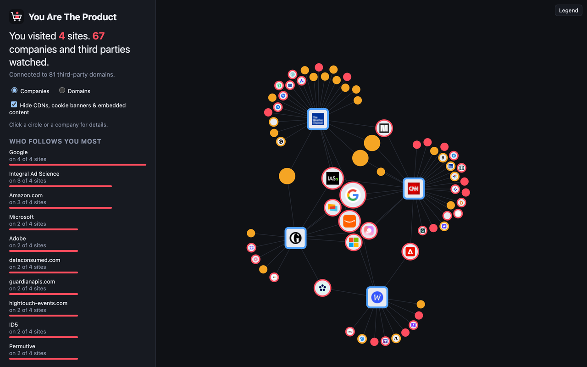
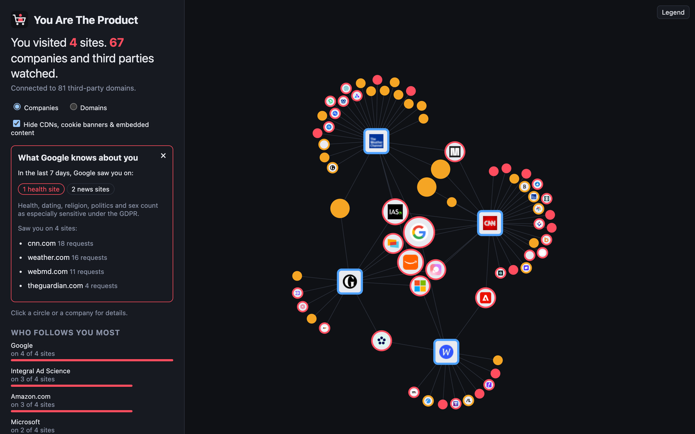

<p align="center">
  
</p>

<h1 align="center">You Are The Product</h1>

<p align="center">
  <a href="README.md">English</a> ·
  <a href="#installieren">Installieren</a> ·
  <a href="#für-lehrkräfte-eine-10-minuten-übung">Für Lehrkräfte</a> ·
  <a href="https://teqneers.github.io/you-are-the-product/PRIVACY.html#deutsch">Datenschutz</a>
</p>

**Eine Browser-Extension, die live zeigt, wer dir beim Surfen zusieht, was diese Firmen erfahren und wer deine
Aufmerksamkeit kauft.** Für Chrome, Firefox und Safari (macOS). Sie blockiert nichts. Sie macht nur sichtbar,
was sonst unsichtbar bleibt.

```
chefkoch.de, eine Rezeptseite. Du klickst auf „Allen Zwecken zustimmen“.

  1 Klick   =  145 Firmen bekommen deine Einwilligung
            +   59 weitere berufen sich auf „berechtigtes Interesse“ (dafür brauche es keine Einwilligung, sagen sie)
               14 Firmen haben dir auf der Seite tatsächlich zugesehen
               Google erfuhr, welche Rezeptliste du angesehen hast: „Pflaumenmarmelade selber machen“
```

Was wir im November 2026 mit dieser Extension außerdem auf echten Seiten gesehen haben (aufgerufen aus
Deutschland, also mit den Cookie-Bannern für die EU):

- **WebMD**, eine große Gesundheitsseite: Ein Klick auf „Accept All“ gibt 56 Firmen deine Einwilligung, 28 weitere
  berufen sich auf „berechtigtes Interesse“. 6 Firmen erfuhren, welche Seite du liest, und 6 der Firmen sind
  registrierte Datenhändler.
- **CNN:** 27 Firmen auf der Startseite, 5 davon liefen, bevor du das Cookie-Banner beantwortet hattest. 7 sind
  registrierte Datenhändler, 10 bekamen deine Daten außerhalb der EU.
- **The Guardian:** Ein Klick auf „Accept all“ gibt 105 Firmen deine Einwilligung, 19 weitere berufen sich auf
  „berechtigtes Interesse“.
- **Spiegel, Stern, t-online, Welt:** 1 bis 3 Tracker liefen, *bevor* du das Cookie-Banner überhaupt
  beantwortet hattest.
- **Zalando** schickt Google deine Seitenaufrufe vor deiner Einwilligung. Ohne Cookies, über Googles „Consent
  Mode“: Es wird noch kein Cookie gesetzt, aber dein Besuch wird trotzdem gemeldet.
- **otto.de** erstellt selbst einen Fingerabdruck deines Browsers: Grafikkarte, Canvas-Zeichnung,
  Audioverarbeitung. Damit erkennt man dich wieder, auch wenn du deine Cookies löschst.
- **In einem Demo-Shop** bekam Facebook die E-Mail-Adresse, die du gerade in ein Newsletter-Feld *getippt*
  hast, Base64-kodiert, bevor du auf Absenden geklickt hast. Das ist kein Gedankenspiel: Forschende fanden
  E-Mail-Adressen, die vor dem Absenden aus Formularen abfließen, auf 1.844 der 100.000 meistbesuchten Websites
  beim Crawlen aus der EU und auf 2.950 aus den USA
  ([Leaky Forms, USENIX Security 2022](https://www.usenix.org/conference/usenixsecurity22/presentation/senol)).

Probier es selbst: Öffne eine beliebige Nachrichtenseite in einem privaten Fenster und sieh auf den Zähler.

## Warum das wichtig ist

**Wenn du nicht bezahlst, bist du das Produkt.** Der größte Teil des Webs ist kostenlos, weil deine
Aufmerksamkeit verkauft wird. Meist nicht dein Name, sondern ein Profil: welche Seiten du liest, welche Produkte
du dir ansiehst, wann du online bist, welches Gerät du nutzt. Jede der 145 Firmen auf dieser Liste kann ein
Stück beitragen.

**Profile entstehen aus Kleinigkeiten.** Eine Rezeptliste allein ist harmlos. Eine Rezeptliste plus ein
Schwangerschaftsforum, drei Jobportale und ein Schuldenrechner erzählen eine Geschichte über dich. Datenhändler
verkaufen genau solche Geschichten. Die US-Handelsbehörde FTC hat neun von ihnen untersucht: Einer hatte 3.000
Datensegmente für fast jeden US-Verbraucher, mit Kategorien wie „Expectant Parent“ (werdende Eltern), „Diabetes
Interest“ und „Cholesterol Focus“
([FTC-Bericht, 2014](https://www.ftc.gov/reports/data-brokers-call-transparency-accountability-report-federal-trade-commission-may-2014)).
Niemand hat diese Menschen gefragt. Niemand hat es ihnen gesagt.

**Dein Besuch wird versteigert, viele Male am Tag.** Lädt eine Seite mit Werbung, wird dein Besuch in
Millisekunden Bietern angeboten, zusammen mit Informationen über dich und die Seite. Der Irish Council for Civil
Liberties schätzt, dass die Daten einer durchschnittlichen Person in Europa so 376-mal am Tag verbreitet werden,
in den USA 747-mal
([ICCL, 2022](https://www.iccl.ie/digital-data/iccl-report-on-the-scale-of-real-time-bidding-data-broadcasts-in-the-u-s-and-europe/)).
Die Extension zeigt diese Auktionen, wenn eine Seite sie in deinem Browser durchführt: „Sold.“

**Profile entscheiden, was du siehst.** Welche Werbung, welche Nachrichten, welche Angebote, womöglich welcher
Preis. Targeting kann die Ängstlichen herausfiltern, die Einsamen, die frisch Verlassenen, die hoch
Verschuldeten. Du siehst nie das Profil, nur die Folgen.

**Manche Seiten zeichnen auf, was du tust, nicht nur, wohin du gehst.** Session-Replay-Skripte erfassen
Mausbewegungen, Klicks und Tippen, sodass jemand deinen Besuch später wie ein Video ansehen kann. Forschende
fanden sie schon 2017 auf 482 der 50.000 meistbesuchten Websites
([Princeton CITP](https://blog.citp.princeton.edu/2017/11/15/no-boundaries-exfiltration-of-personal-data-by-session-replay-scripts)).

**Das Cookie-Banner ist meist Theater.** „Alle akzeptieren“ ist ein leuchtender Knopf, „Ablehnen“ versteckt
sich zwei Bildschirme weiter. Viele Seiten tracken schon, bevor du wählst, und manche machen nach „Ablehnen“
einfach weiter. Eine Einwilligung für 145 Firmen mit einem Klick ist keine informierte Entscheidung, und niemand
erwartet, dass du die Liste liest. Die Extension zeigt dir, was tatsächlich passiert ist, nicht was das Banner
versprochen hat.

**Deine Daten verlassen die EU.** Viele dieser Firmen verarbeiten Daten in den USA oder anderswo, unter anderen
Regeln und mit anderen Zugriffsrechten für Behörden. Eine deutsche Nachrichtenseite heißt nicht, dass deine
Daten in Deutschland bleiben.

**Gegen das, was du nicht siehst, kannst du dich nicht wehren.** Genau darum geht es: keine Angst, sondern
klare Sicht. Wenn du es einmal gesehen hast, entscheidest du selbst, was du akzeptierst, was du ablehnst und
welche Werkzeuge du nutzt.

## Was du siehst

Klick auf das Symbol für die aktuelle Seite, öffne die Seitenleiste, um sie im Blick zu behalten, oder klick auf
„Gesamtbild öffnen“ für alles auf einmal. (Die Bilder zeigen die englische Oberfläche; die Extension spricht 14
Sprachen, auch Deutsch.)

<table>
  <tr>
    <td width="50%"></td>
    <td width="50%"></td>
  </tr>
  <tr>
    <td></td>
    <td></td>
  </tr>
</table>

- **Live-Zähler und Kacheln.** Wie viele Firmen auf dieser Seite sind, gruppiert nach Werbung, Statistik,
  Mitschnitt, Social Media usw., und wie viele erst nach deinem Klick auf „Akzeptieren“ kamen. Die Zahl steht
  auch am Symbol.
- **Wer was bekommt.** Welche Firma erfährt, welche Seite du liest, welche eine ID bekommt, um dich
  wiederzuerkennen, deine Bildschirmgröße und mehr. Und wenn *dieselbe* ID an mehrere Firmen geht, damit sie
  dich abgleichen können.
- **Cookie-Banner-Check.** Tracker, die liefen, bevor du gewählt hast, und solche, die nach „Ablehnen“
  weitermachten. Dazu deine Einwilligung im Klartext: der Einwilligungs-String des Banners, entschlüsselt in die
  Zahl der Firmen, denen du zugestimmt hast, und wer sich auf „berechtigtes Interesse“ beruft.
- **Werbe-Pixel-Decoder.** Was das Pixel von Meta, Google, TikTok, Pinterest oder Snapchat über dich meldet:
  Seite angesehen, in den Warenkorb gelegt, Kauf mit Preis, Suchbegriffe und deine E-Mail-Adresse als Hash
  („Advanced Matching“), damit das Werbenetz deinen Besuch mit deinem Konto verknüpfen kann.
- **Getippte E-Mail.** Firmen, die eine E-Mail-Adresse bekommen, die du in ein Formular getippt hast, als Text,
  Base64 oder Hash, sogar bevor du auf Absenden klickst.
- **Mitschnitt im Scheinwerferlicht.** „Du wirst aufgezeichnet“: Dienste, die Mausbewegungen, Klicks und Tippen
  auf der Seite aufzeichnen. Du kannst deine eigenen letzten 30 Sekunden so abspielen, wie sie sie sehen.
- **Fingerabdruck-Spiegel.** Was Fingerprinting-Skripte über deinen Browser lesen können (Grafikkarte, Canvas,
  Audio, Schriften, Bildschirm, Kerne), das Bild, das sie gezeichnet haben, und eine grobe Schätzung in Bit, wie
  eindeutig das ist.
- **Werbeauktionen („Sold.“).** Prebid-Auktionen auf der Seite und alle Bieter, die Daten über deinen Besuch
  bekommen haben.
- **Getarnte Tracker.** Tracker, die sich hinter einer Subdomain der Seite selbst verstecken (CNAME-Cloaking),
  damit sie wie ein Teil der Seite aussehen und an einfachen Blockern vorbeikommen.
- **Gesamtbild.** Ein Graph aller besuchten Seiten und der Firmen dahinter: wer die meisten Seiten verbindet,
  mit Rangliste, PNG-Export und Präsentationsmodus für Unterricht und Vorträge.
- **14 Sprachen.** Englisch, Deutsch, Spanisch, Französisch, Italienisch, Niederländisch, Polnisch,
  Portugiesisch, Tschechisch, Dänisch, Schwedisch, Finnisch, Japanisch und Koreanisch.

**Neu, in Arbeit:**

- **Globale Reichweite:** auf wie vielen der meistbesuchten Websites eine Firma vorkommt
  (Daten von [WhoTracks.me](https://whotracks.me)).
- **Wochenprofil:** auf welchen Arten von Seiten eine Firma dich gesehen hat, zum Beispiel Gesundheit oder Jobs.
- **Zielländer:** wohin Anfragen gehen und welche Daten die EU verlassen.
- **Datenhändler-Plakette:** Firmen, die in Datenhändler-Registern von US-Bundesstaaten stehen.
- **Tracking-Parameter in Links:** was `fbclid`, `gclid` und Ähnliches bedeuten, sauberen Link kopieren,
  Weiterleitungsketten anzeigen.
- **Cookie-Laufzeit:** „Diese ID folgt dir bis 2028.“
- **Akzeptieren vs. Ablehnen:** dieselbe Seite nach Akzeptieren und nach Ablehnen vergleichen.

## Installieren

Die Extension ist noch nicht in den Stores: **Chrome Web Store, Firefox Add-ons und Mac App Store folgen bald.**

Bis dahin kannst du sie aus einem Build laden (wie man baut, steht in
[docs/DEVELOPMENT.md](docs/DEVELOPMENT.md), auf Englisch):

- **Chrome:** `chrome://extensions` öffnen, „Entwicklermodus“ einschalten, „Entpackte Erweiterung laden“
  klicken und den Ordner `.output/chrome-mv3` wählen.
- **Firefox:** `about:debugging#/runtime/this-firefox` öffnen, „Temporäres Add-on laden…“ klicken und
  `.output/firefox-mv2/manifest.json` wählen. Firefox entfernt es beim nächsten Neustart wieder.

## Deine Privatsphäre

Eine Extension, die Tracker beobachtet, darf nicht selbst einer werden.

- **Alles bleibt in deinem Browser.** Kein Server, kein Konto, keine Statistik. Nichts über dich oder die
  besuchten Seiten wird irgendwohin geschickt. „Alle Daten löschen“ entfernt alles, Deinstallieren ebenfalls.
- **Die einzigen eigenen Netzwerkanfragen:** Favicons von Firmen und Seiten für die Logos (ohne Cookies).
  Die Firmennamen hinter dem Einwilligungs-String eines Cookie-Banners liefert die Extension mit. In Firefox fragt sie außerdem
  DNS-Einträge von Subdomains der besuchten Seite ab, um getarnte Tracker zu erkennen.
- **Sie blockiert nichts.** Sie beobachtet, damit du siehst, was normalerweise passiert. Um dich zu schützen,
  nutze einen echten Blocker wie [uBlock Origin](https://github.com/gorhill/uBlock) oder den Tracking-Schutz
  deines Browsers (zum Beispiel Firefox' Verbesserten Schutz vor Aktivitätenverfolgung auf „Streng“). Dann sieh
  zu, wie der Zähler sinkt.

Details: [Datenschutzerklärung](docs/PRIVACY.md#deutsch).

## Für Lehrkräfte: eine 10-Minuten-Übung

Geeignet für Gruppen ab etwa 12 Jahren. Jedes Paar braucht einen Laptop mit der Extension.

1. **Schätzen (1 Min.).** „Was glaubt ihr, wie viele Firmen zusehen, wenn ihr eine Rezeptseite öffnet?“ Die
   Schätzungen an die Tafel schreiben.
2. **Akzeptieren (3 Min.).** Ein *privates Fenster* öffnen (damit keine alten Cookies mitzählen), `chefkoch.de`
   oder `spiegel.de` aufrufen und im Cookie-Banner „Alle akzeptieren“ klicken. Die Extension öffnen. Wie viele
   Firmen? Wie viele kamen erst nach dem Klick? Was steht unter „Deine Einwilligung“?
3. **Ablehnen (3 Min.).** Das private Fenster schließen, ein neues öffnen, dieselbe Seite, diesmal „Ablehnen“
   klicken (eventuell muss man danach suchen). Noch einmal zählen. Lief schon etwas, bevor ihr gewählt habt? Ist
   nach „Ablehnen“ noch jemand da?
4. **Besprechen (3 Min.).** Die Zahlen mit den Schätzungen vergleichen. Warum ist „Akzeptieren“ so viel leichter
   zu finden als „Ablehnen“? Wer bezahlt die Seite? Was könnte eine Firma aus einer Woche Surfen über dich
   erfahren?

Für die ganze Klasse „Gesamtbild öffnen“ klicken und „Präsentation“ einschalten: Der Graph zeigt, wie eine
Handvoll Firmen fast jede besuchte Seite miteinander verbindet.

## Mitmachen, Lizenz, Kontakt

- Entwicklerdokumentation (Build, Safari, Datenquellen und Lizenzen, Tests, Veröffentlichung), auf Englisch:
  [docs/DEVELOPMENT.md](docs/DEVELOPMENT.md)
- Code: [GPL-3.0-or-later](LICENSE), herausgegeben von teqneers. Tracker-Daten von
  [DuckDuckGo Tracker Blocklists](https://github.com/duckduckgo/tracker-blocklists) unter
  [CC BY-NC-SA 4.0](https://creativecommons.org/licenses/by-nc-sa/4.0/). Alle Datenquellen und ihre Lizenzen
  stehen in [docs/DEVELOPMENT.md](docs/DEVELOPMENT.md#data-sources-and-licences).
- Inspiriert von Mozillas Lightbeam.
- Kontakt: [you-are-the-product@teqneers.de](mailto:you-are-the-product@teqneers.de)
